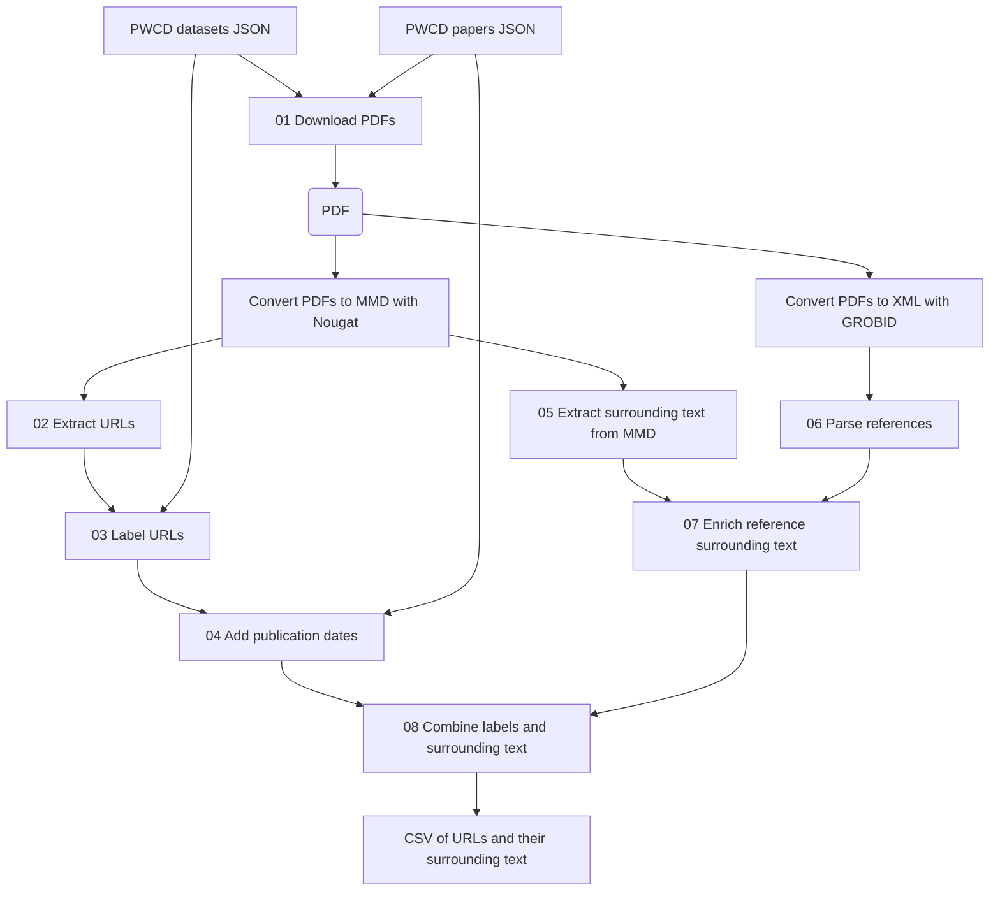

# Constructing a Dataset of Research Data Publication URLs

[日本語版 / Japanese version](README_JA.md)

This directory contains code for constructing a dataset of URLs and their surrounding text extracted from scholarly papers reporting the production of research data (data-producing papers). Each URL is labeled according to whether it indicates the publication location of the research data corresponding to the given paper.

## 1. Workflow and Script Descriptions



All paths below are relative to the repository root, `data-producing/`. PWCD refers to the archived data from Papers With Code (PWC).

| Script | Description |
| --- | --- |
| [`01_download_pdfs.py`](scripts/01_download_pdfs.py) | **Downloads the PDFs of data-producing papers.** Reads the two PWCD JSON files, matches paper titles in the datasets JSON against the papers JSON by exact equality, and saves the PDFs in `data/pdf/`. Records unmatched titles, multiple matches, missing URLs, and download failures in `data/logs/{not_found,many_match,no_url,failed_download}.json`. |
| [`02_extract_urls.py`](scripts/02_extract_urls.py) | **Extracts candidate URLs from text-format papers for dataset construction.** Reads `*.mmd` files directly under `data/mmd/` and writes `data/intermediate/extracted_urls.json` in the form `{filename: [URL, ...]}`. |
| [`making_dataset_produce_or_not_url_classify.py`](scripts/making_dataset_produce_or_not_url_classify.py) | **Determines whether extracted URLs match publication locations of the corresponding research data by comparison with PWCD records.** Reads the PWCD datasets JSON and `extracted_urls.json`, and provides the classification functions called by `03`. |
| [`03_label_urls.py`](scripts/03_label_urls.py) | **Labels each URL according to whether it indicates the publication location of the corresponding research data and saves the results as a CSV.** Uses the classifier above to create `data/intermediate/labelled.csv` with columns `id,name,homepage,paper_title,label`. Positive examples (`Produce`) use homepages registered in the PWCD datasets JSON; negative examples (`nonProduce`) use other extracted URLs. Retains negative examples only for papers with at least one positive example. |
| [`04_add_year.py`](scripts/04_add_year.py) | **Adds the publication date of each paper to the URL records.** Joins `labelled.csv` with the PWCD papers JSON and creates `data/intermediate/labelled_with_year.csv` with columns `id,name,homepage,paper_title,year,label`. |
| [`05_parse_mmd_context.py`](scripts/05_parse_mmd_context.py) | **Extracts sentences, paragraphs, section titles, and footnote text associated with URLs in scholarly papers.** Recursively reads `data/mmd/` and creates `data/intermediate/pt_cs_ci_dict_output.json`. Classifies URL positions as `Body`, `Footnote`, or `Reference` and inserts citation tags. Requires `en_core_web_trf`. |
| [`grobid.py`](scripts/grobid.py) | **Converts paper PDFs into structured XML to provide input for reference analysis.** |
| [`06_parse_tei_references.py`](scripts/06_parse_tei_references.py) | **Links URLs in references to the sentences and paragraphs containing their in-text citation tags.** Recursively reads `data/xml/` and creates `data/intermediate/xml_ref_dict.json`. |
| [`07_add_reference_info.py`](scripts/07_add_reference_info.py) | **Enriches the surrounding text of URLs in references with in-text citation information.** Reads `pt_cs_ci_dict_output.json` and `xml_ref_dict.json`, and creates `data/intermediate/url_around_info.json` and `reference_merge_report.json`. |
| [`08_combine_context.py`](scripts/08_combine_context.py) | **Combines URL labels and publication dates with surrounding text to construct the dataset.** Joins `labelled_with_year.csv` with `url_around_info.json`, and creates `data/intermediate/dataset_with_context.csv` and `combine_report.json`. |

## 2. Directory and File Structure

```text
data-producing/
├── .gitignore
├── README.md                 # English README
├── README_JA.md              # Japanese README
├── requirements.txt         # Python dependencies
├── scripts/                 # Scripts listed above
└── data/
    ├── input/               # PWC datasets / papers JSON files
    ├── pdf/                 # Paper PDFs
    ├── mmd/                 # Text-format papers converted with Nougat
    ├── xml/                 # Full-text TEI XML generated with GROBID
    ├── intermediate/        # Intermediate CSV/JSON, final dataset, and merge reports
    └── logs/                # PDF download records
```

### Input Data and Download Links

Place the following JSON files in `data/input/`.

| Input data | Current filename | Download link |
| --- | --- | --- |
| PWC dataset JSON | `datasets_JST202508081105.json` | [PWC dataset archive](https://huggingface.co/datasets/pwc-archive/datasets) |
| PWC papers JSON | `papers-with-abstracts_JST202508081105.json` | [PWC papers archive](https://huggingface.co/datasets/pwc-archive/papers-with-abstracts) |

## 3. Environment Setup

- Create a virtual environment with 64-bit Python and install the dependencies in [requirements.txt](requirements.txt). Python 3.12 is the setup target. The requirements also include spaCy's English model `en_core_web_trf`, using the [official 3.8.0 release](https://github.com/explosion/spacy-models/releases/tag/en_core_web_trf-3.8.0).
- Install Nougat in a separate virtual environment to convert PDFs to MMD.
- Set up a GROBID service at `http://localhost:8070` to convert PDFs to XML.
- Scripts `05` and `06` use a GPU by default. For GPU execution, follow [spaCy's GPU installation instructions](https://spacy.io/usage#gpu) and install CuPy and PyTorch builds compatible with your CUDA environment.

## 4. Execution Procedure

Use the repository root, `data-producing/`, as the working directory and check the output of each stage before proceeding.

1. **Prepare the input data:** Place the two PWC JSON files in `data/input/`.
2. **Obtain and convert the papers:** Download PDFs with `01_download_pdfs.py`, convert them to MMD with Nougat, and save the MMD files in `data/mmd/`. Also start the GROBID service, generate XML with `grobid.py`, and save it in `data/xml/`.
3. **Label URLs and add publication dates:** Process the files in the order `02_extract_urls.py` → `03_label_urls.py` → `04_add_year.py`.
4. **Extract the surrounding text of URLs:** Parse MMD with `05_parse_mmd_context.py` and XML with `06_parse_tei_references.py`.
5. **Combine the data:** Process the files in the order `07_add_reference_info.py` → `08_combine_context.py`, then check the final CSV and merge reports.

For each paper, use matching filenames for its PDF, MMD, and XML, differing only in their extensions. Place MMD files directly under `data/mmd/` so that `02` can read them.

## 5. Contents of the Output Dataset

The final output is `data/intermediate/dataset_with_context.csv`. Each row contains a labeled URL and the following information associated with its occurrence in the paper.

| Information | Main columns and contents |
| --- | --- |
| Basic information | `id`, `name`, `paper_title`, `year`: ID, dataset name, paper title, and paper publication date. |
| URL and label | `homepage`, `label`: The URL to be classified and its `Produce` / `nonProduce` label based on PWC records. |
| URL position | `Passage-title`, `Citation-type`: Section titles and the URL position type (body, footnote, or reference). |
| Surrounding text | `Citation-sentence`, `Citation-paragraph`, `Context-three-sentences`: The sentence containing the URL or the corresponding footnote/citation tag, its paragraph, and the immediately preceding and following sentences within the same paragraph. |
| Citation information | `Citation-info`: Footnote text or bibliographic information described in the reference. |

`Produce` indicates a URL registered in PWCD as the publication location of the research data whose production is reported in the given paper. `nonProduce` indicates other URLs labeled as negative during classification. Rows that cannot be joined with surrounding text are excluded from the final CSV and recorded in `combine_report.json`.

The `data/intermediate/` directory also stores CSV and JSON files from each processing stage, along with `reference_merge_report.json`, which records the results of reference enrichment.

## 6. Research Paper Using This Code

- **Title:** Where Are Research Data Published? Identifying Their Publication URLs in Scholarly Papers
- **Authors:** Ryoma Okada, Koshi Motegi, Koichiro Ito, and Shigeki Matsubara
- **Venue:** Proceedings of the 28th International Conference on Asia-Pacific Digital Libraries ([ICADL 2026](https://icadl.net/icadl2026/)) (to appear)
- **Year:** 2026
- **Paper URL or DOI:** [Add the paper URL or DOI here when available]
