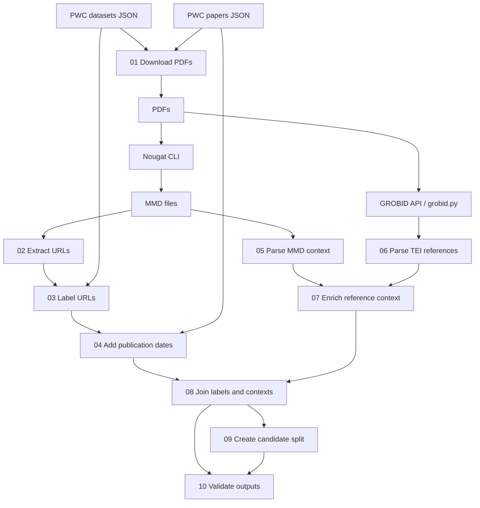

# Research data publication URL dataset construction

[日本語版 / Japanese](README_JA.md)

This guide explains every current file in `scripts/` and the commands needed to construct a dataset of URLs mentioned in scholarly papers. URLs are labeled by comparison with a paper's research dataset homepage in Papers with Code (PWC). PDFs are converted to `.mmd` with **Nougat**; GROBID supplies full-text TEI XML for reference contexts.

**Run commands from `data-producing/data_construction_release/`**, where `requirements.txt`, `scripts/`, and `data/` are located. Running from `data-producing/` or inside `scripts/` changes the meaning of hard-coded relative paths.

Historical package versions, Nougat settings, and exact experimental split membership are unknown. The current three-sentence feature and candidate split include reconstructed implementations. Published counts are comparison targets, not a reproduction guarantee. `REVIEW_JA.md` is an older audit; its statements about missing context parsers and extraction filenames do not describe the current scripts. Use this guide for the current version.

## 1. Workflow and every script



All paths below are relative to this directory. `making_dataset.py` is an optional preliminary export.

| Script | Purpose, inputs, and outputs |
| --- | --- |
| [`making_dataset.py`](scripts/making_dataset.py) | **Creates a preliminary CSV of papers and their registered dataset homepages for inspection.** Reads `data/input/datasets_JST202508081105.json`, exports `data/intermediate/pwc_pairs.csv` with `id,name,homepage,paper_title,label`, labeling every exported row `Produce`. Prefers `paper` when both paper fields exist. Also supplies loading/unique-title functions to `01`. Its CSV is not read by subsequent stages. `pwc_pairs.csv` stores dataset names, homepages, corresponding paper titles, and preliminary positive labels. |
| [`01_download_pdfs.py`](scripts/01_download_pdfs.py) | **Downloads the scholarly PDFs used as source documents for the dataset.** Reads both PWC JSON files, matches unique dataset paper titles to papers by **exact title equality**, and downloads `url_pdf` into `data/pdf/`. **Processes only the first 20 titles by default.** Logs missing/ambiguous titles, missing URLs, and failures in `data/logs/{not_found,many_match,no_url,failed_download}.json`. Requires HTTP 200 and PDF content type; skips existing filenames. Old substring-matching comments do not reflect the code. The saved PDFs contain the full papers used as source material. Each log JSON stores affected paper titles and, for failed downloads, the attempted URL. |
| [`02_extract_urls.py`](scripts/02_extract_urls.py) | **Extracts candidate URLs from the paper text for inclusion in the dataset.** Reads only top-level `data/mmd/*.mmd`. Writes `data/intermediate/perfect_extracted_urls.json` as `{filename_stem: [URL, ...]}`. Regex extracts HTTP(S)/FTP URLs, `modify_url` tries to extend broken URLs, edge punctuation is removed, URLs are deduplicated, then trimmed at the first parenthesis. This last trimming can introduce duplicates. No surrounding text is written. The output JSON stores a list of URLs extracted from the body, footnotes, and bibliography for each paper. |
| [`making_dataset_produce_or_not_url_classify.py`](scripts/making_dataset_produce_or_not_url_classify.py) | **Checks extracted URLs against PWC records to determine whether they match a research dataset's publication URL.** Reads datasets JSON and `perfect_extracted_urls.json`; provides classification functions imported by `03`. Titles **and URLs** are lowercased after removing every non-ASCII-alphanumeric character, then compared for equality. Running directly prints statistics; it does not write a dataset file. |
| [`03_label_urls.py`](scripts/03_label_urls.py) | **Assigns publication-URL labels to the URLs and saves the labeled examples as a CSV.** Uses that classifier to write `data/intermediate/labelled.csv`, columns `id,name,homepage,paper_title,label`. Positive (`Produce`) rows retain PWC homepages; negatives (`nonProduce`) retain extracted URLs and a blank dataset name. Negatives are kept only for papers with at least one positive. See section 7 for label/duplicate caveats. `labelled.csv` stores each URL's paper title, dataset name, and publication-URL label. |
| [`04_add_year.py`](scripts/04_add_year.py) | **Adds each paper's publication date to the URL examples so they can be split chronologically.** Joins `labelled.csv` to papers JSON by original title **exact equality**. Writes `data/intermediate/labelled_with_year.csv`, columns `id,name,homepage,paper_title,year,label`. Unmatched rows are dropped. `year` contains the full `date` string, normally `YYYY-MM-DD`, rather than the year alone. `labelled_with_year.csv` stores the labeled URL records with each paper's publication date added. |
| [`05_parse_mmd_context.py`](scripts/05_parse_mmd_context.py) | **Extracts the sentences, paragraphs, section headings, and footnote information surrounding URLs in the paper text.** Recursively reads `data/mmd/`; writes `data/intermediate/pt_cs_ci_dict_output.json`. Splits at blank lines, tracks Markdown headings, segments sentences with spaCy, heuristically links `Footnote N:` to nearby body references, expands URLs into records, classifies `Body`/`Footnote`/`Reference`, and inserts citation tags. Requires `en_core_web_trf`; calls `spacy.require_gpu()` unless `DATASET_PARSER_CPU=1`. The output JSON groups URL records by paper, storing the containing sentence, paragraph, headings, footnote information, and citation type. |
| [`grobid.py`](scripts/grobid.py) | **Converts paper PDFs into structured XML to provide input for reference analysis.** POSTs PDFs as multipart field `input` to `http://localhost:8070/api/processFulltextDocument`, saving full-text TEI XML with corresponding PDF stems. Current source uses fixed `/workspace/...` input/output paths, creates an unrelated `/mnt/ssd/研究/xml` directory, and accesses `input_files[0]` even when no PDFs exist. Apply section 4's path edits before running elsewhere. Imports `tqdm`, absent from `requirements.txt`. The output XML stores structured paper text, section headings, bibliography entries, and their links to in-text citations. |
| [`06_parse_tei_references.py`](scripts/06_parse_tei_references.py) | **Links bibliography URLs to the body sentences and paragraphs that cite them.** Recursively reads `data/xml/`; writes `data/intermediate/xml_ref_dict.json`. Resolves TEI `listBibl/biblStruct`, `ptr target`, and body `ref type="bibr"` links to extract in-text sentence/paragraph/headings and bibliography fields. Its heading key is `Paragraph-title`. Requires the same model/CPU setting as `05`. Active XML parsing uses ElementTree; the lxml alternative is commented out, but lxml is still imported. The output JSON groups records by paper, storing bibliography URLs, bibliographic details, and the body sentences, paragraphs, and headings associated with their citations. |
| [`07_add_reference_info.py`](scripts/07_add_reference_info.py) | **Enriches the context of bibliography URLs with their in-text citation information.** Reads `pt_cs_ci_dict_output.json` and `xml_ref_dict.json`; writes `data/intermediate/url_around_info.json` and `reference_merge_report.json`. Enriches only existing MMD `Reference` records. Titles use exact matching with normalized fallback; URLs require **exact string equality**. Multiple TEI contexts expand a record; unmatched MMD records remain. XML-only URLs are not newly added. `url_around_info.json` stores the enriched URL contexts; `reference_merge_report.json` stores match counts and information about unmatched references and papers. |
| [`08_combine_context.py`](scripts/08_combine_context.py) | **Combines URL labels and publication dates with surrounding text to assemble the dataset of contextual examples.** Joins `labelled_with_year.csv` with `url_around_info.json`; writes `data/intermediate/dataset_with_context.csv` and `combine_report.json`. Titles use exact matching with normalized fallback; default URL matching uses classifier normalization. Every matching context occurrence produces a row. Adds the target sentence and neighbors from the same paragraph; paragraph boundaries yield fewer than three sentences. Unmatched label rows are omitted and reported. `dataset_with_context.csv` stores paper titles, dates, labels, surrounding text, and footnote or bibliography information for each matching URL occurrence. `combine_report.json` stores join counts, unmatched rows, and three-sentence context recovery statuses. |
| [`09_split_candidate.py`](scripts/09_split_candidate.py) | **Splits the constructed dataset into training, development, and test sets in paper publication-date order.** Reads the combined CSV; writes `data/intermediate/split_candidate/{train,dev,test}.csv` and `split_report.json`. Sorts distinct papers by date, then title, allocating `max(1, round(papers * 0.1))` latest papers to test, preceding papers to dev, and the remainder to train. Requires at least three papers and valid/consistent dates. Approximate 8:1:1 is by **paper count**, not row count. This is a new candidate split and does not apply the historical exclusion list. `train.csv`, `dev.csv`, and `test.csv` store the contextual URL records assigned to each subset. `split_report.json` stores paper, row, and positive counts and date ranges for each split. |
| [`10_validate_outputs.py`](scripts/10_validate_outputs.py) | **Checks the format and consistency of the constructed dataset and its splits.** Reads the combined CSV, all three splits, and combine report; writes `data/intermediate/validation_report.json`. Checks required columns, nonempty output, label values, nonempty title/URLs, report count, exact split partition including duplicates, and separation of papers. Structural errors exit with status 1; published-count differences alone do not. `validation_report.json` stores detected structural errors, actual counts, comparisons with published counts, label totals, and unmatched-row counts. |

Note: `09_split_candidate.py` and `10_validate_outputs.py` are currently absent from `scripts/`. Their two rows above describe the output specifications documented in the existing README.

## 2. Inputs and directory layout

The PWC snapshots are not distributed here, and no script downloads them. Obtain the archived experiment inputs and use the expected names. For another snapshot, keep these names or edit every corresponding source path; the results depend on the snapshot.

```text
data_construction_release/
├── README.md
├── README_JA.md
├── requirements.txt
├── scripts/
├── original/                 # historical source
├── original_additional/     # additional historical source
└── data/
    ├── input/
    │   ├── datasets_JST202508081105.json
    │   └── papers-with-abstracts_JST202508081105.json
    ├── pdf/                 # downloaded PDFs
    ├── mmd/                 # Nougat output
    ├── xml/                 # GROBID full-text TEI
    ├── intermediate/        # CSV/JSON/reports/split_candidate
    └── logs/                # download/environment records
```

Both JSON files must be **top-level lists**, not JSONL or dictionaries. Minimal illustrative schemas follow; these example URLs are not test downloads.

`datasets_JST202508081105.json`:

```json
[
  {
    "name": "Example Dataset",
    "homepage": "https://example.org/dataset",
    "paper": {"title": "Example Paper"},
    "verified_paper": null
  }
]
```

`papers-with-abstracts_JST202508081105.json`:

```json
[
  {
    "title": "Example Paper",
    "date": "2024-01-15",
    "url_pdf": "https://example.org/paper.pdf",
    "conference_url_pdf": null
  }
]
```

Include both `paper` and `verified_paper` keys, setting unused values to null. `conference_url_pdf` must also exist, even when null: `01` directly accesses it for statistics, but does not fall back to it for downloads.

The downloader replaces `\ / * ? : " < > |` in titles with `_`. Keep matching stems for `Example Paper.pdf`, `Example Paper.mmd`, and `Example Paper.xml`; stems become title keys. Put MMDs **directly in `data/mmd/`** because `02` does not recurse. Renamed/colliding stems can cause unmatched or ambiguous normalized titles.

## 3. Environment setup

These examples use **Python 3.10 and CPU parsing** as a starting point, not the recovered historical environment. Source syntax requires Python 3.9+, but package compatibility matters too. `requirements.txt` is unpinned. Keep Nougat separate because of its transformer/image-processing dependencies.

| Dependency | Purpose |
| --- | --- |
| `requests` | Download PDFs and contact GROBID |
| `pandas` | CSV processing in `03`; also imported by `05`/`06` |
| `scikit-learn` | Retained in `requirements.txt`; not used by the current scripts |
| `spacy`, `spacy-transformers` | Sentence segmentation in `05`/`06`/`08` |
| `en_core_web_trf` | Separately downloaded English transformer model |
| `lxml` | Import in `06`, including its inactive alternative parser |
| `tqdm` | GROBID progress display; install separately |
| `nougat-ocr` | External PDF-to-MMD CLI in a separate environment |
| Docker + GROBID image | External PDF-to-TEI service, not a pip dependency |

uv installs Python and creates environments; see its official [installation](https://docs.astral.sh/uv/getting-started/installation/) and [Python management](https://docs.astral.sh/uv/guides/install-python/) guides.

### 3.1 Linux / WSL (Bash)

To use WSL on Windows, run this in an administrator PowerShell, restart if prompted, open Ubuntu, and complete initial user setup. See [Microsoft's WSL guide](https://learn.microsoft.com/en-us/windows/wsl/install).

```powershell
wsl --install -d Ubuntu
```

Run the following **inside Ubuntu/Bash**, not PowerShell:

```bash
sudo apt update
sudo apt install -y curl ca-certificates
curl -LsSf https://astral.sh/uv/install.sh | sh
```

Reopen the terminal as instructed by the installer. Replace the example checkout path below. WSL exposes Windows files under `/mnt/c/`.

```bash
cd '/path/to/data-producing/data_construction_release'
uv --version
uv python install 3.10
uv venv --python 3.10 --seed .venv
.venv/bin/python -m pip install -r requirements.txt
.venv/bin/python -m pip install tqdm
.venv/bin/python -m spacy download en_core_web_trf
.venv/bin/python -m spacy validate
.venv/bin/python --version
mkdir -p data/input data/pdf data/mmd data/xml data/intermediate data/logs
export PYTHONUTF8=1
export DATASET_PARSER_CPU=1
```

Install the model in the **same environment** as the scripts, as documented by [spaCy](https://spacy.io/usage/models). `PYTHONUTF8=1` covers historical `open()` calls without an explicit encoding. The CPU variable prevents `05`/`06` from requiring a GPU. CPU execution may be slow. In later sessions, return to this directory and reset both variables. Explicit `.venv/bin/python` paths mean activation is unnecessary.

### 3.2 Native Windows (PowerShell)

Install uv, then reopen PowerShell:

```powershell
winget install --id=astral-sh.uv -e
```

This example starts in `data-producing/`; omit `Set-Location` if already in `data_construction_release/`.

```powershell
Set-Location .\data_construction_release
uv --version
uv python install 3.10
uv venv --python 3.10 --seed .venv
$Python = ".\.venv\Scripts\python.exe"
& $Python -m pip install -r requirements.txt
& $Python -m pip install tqdm
& $Python -m spacy download en_core_web_trf
& $Python -m spacy validate
& $Python --version
New-Item -ItemType Directory -Force -Path data/input,data/pdf,data/mmd,data/xml,data/intermediate,data/logs | Out-Null
$env:PYTHONUTF8 = "1"
$env:DATASET_PARSER_CPU = "1"
```

Reset `$Python` and the variables in each new terminal. Explicit executable paths avoid activation issues. In Bash examples below, replace `.venv/bin/python` with `& $Python`; section 5 also provides the PowerShell sequence.

### 3.3 Optional GPU parsing

For GPU use in `05`/`06`, configure compatible NVIDIA drivers, PyTorch, and CuPy/spaCy CUDA dependencies using the official [PyTorch](https://pytorch.org/get-started/locally/), [spaCy GPU](https://spacy.io/usage#gpu), and [CuPy](https://docs.cupy.dev/en/stable/install.html) installation guides. The repository requirements do not supply the GPU setup. Verify it in the main environment, then remove the CPU override:

```bash
.venv/bin/python -c "import torch, spacy; print('torch CUDA:', torch.cuda.is_available()); spacy.require_gpu(); print('spaCy GPU ready')"
unset DATASET_PARSER_CPU
```

PowerShell:

```powershell
& $Python -c "import torch, spacy; print('torch CUDA:', torch.cuda.is_available()); spacy.require_gpu(); print('spaCy GPU ready')"
Remove-Item Env:DATASET_PARSER_CPU -ErrorAction SilentlyContinue
```

`08` loads its model without explicitly selecting GPU. `DATASET_PARSER_CPU` is used only by `05`/`06`; it does not select the Nougat device.

## 4. Source adjustments before a full run

This documentation does not automatically apply these source changes.

### 4.1 Remove the 20-paper download limit

For a full run, edit `scripts/01_download_pdfs.py`:

```python
# Current small-run limit:
papers_title_list = making_dataset.paper_verified_paper_nodup(dataset_li)[:20]
# Full run: replace the line above with:
papers_title_list = making_dataset.paper_verified_paper_nodup(dataset_li)
```

Keep the first version for an initial small run. The limit counts distinct paper titles, not dataset records or final URL rows. There is no `--limit` CLI option.

### 4.2 Make GROBID paths portable

Edit `scripts/grobid.py` before running outside its original Linux layout:

1. Replace the PDF glob with `input_files = glob.glob("data/pdf/*.pdf")`.
2. Delete the standalone `input_files[0].split(...)` expression, which fails when no PDFs exist.
3. Replace the `/mnt/ssd/研究/xml` directory creation with `os.makedirs("data/xml", exist_ok=True)`.
4. In the loop, use `output_file_name = os.path.splitext(os.path.basename(input_file))[0]` and `output_file = os.path.join("data/xml", f"{output_file_name}.xml")`.

Keep the local server URL when it is reachable on port 8070. These path edits work in Bash and native Windows. Confirm PDFs exist. The original script overwrites XML on rerun, prints HTTP errors, and has no timeout or retry mechanism.

## 5. Execution from scratch

Check each stage's output before advancing. Do not run all numbered files with a wildcard: Nougat/GROBID must run between Python stages.

### 5.1 Optional PWC export and PDF download

Place the two input JSONs and decide whether to remove `[:20]` first:

```bash
.venv/bin/python scripts/making_dataset.py
.venv/bin/python scripts/01_download_pdfs.py
ls data/pdf/*.pdf
```

The first command is optional: `01` imports functions but does not need `pwc_pairs.csv`. Review download logs. Existing PDF content is not checked; logs append and can duplicate records on rerun. The printed download-target count is not a success count.

### 5.2 Convert PDFs to MMD using Nougat

Create a dedicated environment **inside `.venv/`**, already ignored by Git:

```bash
uv venv --python 3.10 --seed .venv/nougat
.venv/nougat/bin/python -m pip install nougat-ocr
.venv/nougat/bin/nougat --help
.venv/nougat/bin/nougat data/pdf -o data/mmd -m 0.1.0-small
ls data/mmd/*.mmd
```

Installation, directory input, and model options follow [Nougat's official documentation](https://github.com/facebookresearch/nougat). This is an example, not the verified historical invocation. Record the actual command/model/options. Weights may download on first use. Preserve PDF stems in the MMD names.

If Nougat MMDs already exist, place them directly in `data/mmd/` and skip conversion. Inspect headings, footnotes, and URLs. For frequent `[MISSING_PAGE]`, Nougat documents `--no-skipping`; `--recompute` also regenerates existing files. These options affect downstream results.

PowerShell equivalent:

```powershell
uv venv --python 3.10 --seed .venv/nougat
& .\.venv\nougat\Scripts\python.exe -m pip install nougat-ocr
& .\.venv\nougat\Scripts\nougat.exe --help
& .\.venv\nougat\Scripts\nougat.exe data/pdf -o data/mmd -m 0.1.0-small
Get-ChildItem data/mmd -Filter *.mmd
```

For Windows GPU use, Nougat's documentation calls for installing the appropriate PyTorch build first, **in this Nougat environment**.

### 5.3 Extract URLs, label them, and add dates

```bash
.venv/bin/python scripts/02_extract_urls.py
.venv/bin/python scripts/03_label_urls.py
.venv/bin/python scripts/04_add_year.py
```

Expected outputs are `data/intermediate/perfect_extracted_urls.json`, `labelled.csv`, and `labelled_with_year.csv`. `03` reads **`perfect_extracted_urls.json`**, not `no_kagikakko_extracted_urls.json`. No `02b_trim_parentheses_optional.py` exists in the current `scripts/` directory.

### 5.4 Parse MMD context

```bash
export DATASET_PARSER_CPU=1
.venv/bin/python scripts/05_parse_mmd_context.py
```

Output: `data/intermediate/pt_cs_ci_dict_output.json`. This script executes at module level, loads the model immediately, and writes the whole JSON at the end. It has no CLI options or per-paper resume support. Empty/unreadable inputs and unrecognized headings/context can reduce records relative to URL extraction.

### 5.5 Start GROBID and obtain full-text TEI XML

Install Docker using [Docker Desktop for Windows](https://docs.docker.com/desktop/setup/install/windows-install/) or [Docker Engine for Linux](https://docs.docker.com/engine/install/). Start Linux containers; enable integration for your WSL distribution when using WSL. Confirm `docker version` succeeds.

This example uses an explicit tag, not the recovered experimental version. The full image includes reference-processing models; see [GROBID's Docker guide](https://grobid.readthedocs.io/en/latest/Grobid-docker/).

```bash
docker pull grobid/grobid:0.9.1-full
docker run -d --name grobid-data-construction --init --ulimit core=0 -p 8070:8070 grobid/grobid:0.9.1-full
docker logs grobid-data-construction
curl -f http://localhost:8070/api/isalive
```

Wait for initialization and a successful response. The image is large; CPU processing can take time. If the named container exists, use `docker start grobid-data-construction`. Port 8070 must be free. This example uses CPU; GPU containers need additional configuration.

After section 4.2's source changes:

```bash
.venv/bin/python scripts/grobid.py
ls data/xml/*.xml
.venv/bin/python scripts/06_parse_tei_references.py
```

Outputs: `data/xml/<PDF stem>.xml` files and `data/intermediate/xml_ref_dict.json`. Use full-text TEI with bibliography structures and body citation links, not arbitrary XML or a reference-only export. The endpoint/multipart upload follows the [GROBID REST API](https://grobid.readthedocs.io/en/latest/Grobid-service/).

If matching TEI XML already exists, put it in `data/xml/`, skip generation, and run `06`. Stop the server when finished:

```bash
docker stop grobid-data-construction
```

### 5.6 Merge, split, and validate

```bash
.venv/bin/python scripts/07_add_reference_info.py
.venv/bin/python scripts/08_combine_context.py
.venv/bin/python scripts/09_split_candidate.py
.venv/bin/python scripts/10_validate_outputs.py
```

Final artifacts:

- `data/intermediate/dataset_with_context.csv`: labeled context occurrences.
- `data/intermediate/split_candidate/train.csv`, `dev.csv`, `test.csv`: candidate splits.
- `reference_merge_report.json`, `combine_report.json`, `validation_report.json` under `data/intermediate/`; `split_report.json` under `split_candidate/`.

Review section 7's reports. `10` needs all three splits and the combine report. Exit status 0 does not establish historical reproduction or context accuracy.

### 5.7 PowerShell execution sequence

After setup, input placement, and section 4's edits, use this native Windows sequence. Check outputs between stages; skip generation for existing MMD/XML files.

```powershell
$Python = ".\.venv\Scripts\python.exe"
$env:PYTHONUTF8 = "1"
$env:DATASET_PARSER_CPU = "1"
& $Python scripts/making_dataset.py
& $Python scripts/01_download_pdfs.py

# First create/install the Nougat environment from section 5.2.
& .\.venv\nougat\Scripts\nougat.exe data/pdf -o data/mmd -m 0.1.0-small
& $Python scripts/02_extract_urls.py
& $Python scripts/03_label_urls.py
& $Python scripts/04_add_year.py
& $Python scripts/05_parse_mmd_context.py

# Start Docker Desktop first.
docker pull grobid/grobid:0.9.1-full
docker run -d --name grobid-data-construction --init --ulimit core=0 -p 8070:8070 grobid/grobid:0.9.1-full
docker logs grobid-data-construction
Invoke-RestMethod -Uri http://localhost:8070/api/isalive
# Wait for successful initialization before sending PDFs.
& $Python scripts/grobid.py
& $Python scripts/06_parse_tei_references.py
& $Python scripts/07_add_reference_info.py
& $Python scripts/08_combine_context.py
& $Python scripts/09_split_candidate.py
& $Python scripts/10_validate_outputs.py
$LASTEXITCODE
docker stop grobid-data-construction
```

### 5.8 Optional MMD-only variant

Without TEI, after `04` and `05` use:

```bash
.venv/bin/python scripts/08_combine_context.py --contexts data/intermediate/pt_cs_ci_dict_output.json
.venv/bin/python scripts/09_split_candidate.py
.venv/bin/python scripts/10_validate_outputs.py
```

This skips `06`/`07`, retaining MMD bibliography context rather than TEI body citations. Record the variant. Default output names are identical, so preserve both runs in separate working copies or supply custom paths.

## 6. Output fields and CLI options

The combined CSV keeps `id,name,homepage,paper_title,year,label` and appends:

| Field | Meaning |
| --- | --- |
| `Passage-title` | Heading hierarchy, serialized as a JSON list in a CSV cell. |
| `Citation-sentence` | Sentence containing the URL or its footnote/reference citation. |
| `Citation-info` | Footnote or bibliography information; normally empty for body URLs. `06` renders bibliography dictionaries as Python dictionary strings, not JSON objects. |
| `Citation-paragraph` | Paragraph containing the sentence/citation. |
| `Citation-type` | `Body`, `Footnote`, or `Reference`. |
| `Context-three-sentences` | Target sentence and neighbors within the same paragraph; falls back to the target sentence on matching failure. |
| `Source-URL` | URL extracted by the context parser, retained separately from the labeled homepage. |

A positive `homepage` can differ textually from `Source-URL`. Tags include `[Cite]`, `[Cite_Ref]`, and `[Cite_Footnote_N]`. `id` is inherited from labels and repeats when one label expands to multiple contexts; it is not occurrence-unique.

Only `07`–`10` expose argparse options. Use `.venv/bin/python scripts/<name>.py --help` (PowerShell: `& $Python ...`). Do not pass `--help` to `05`/`06`/`grobid.py`, which execute at module level.

| Script | Options |
| --- | --- |
| `07_add_reference_info.py` | `--mmd`, `--xml`, `--out`, `--report` |
| `08_combine_context.py` | `--labels`, `--contexts`, `--out`, `--report`, `--url-mode normalized\|exact\|legacy-substring`, `--skip-three-sentences` |
| `09_split_candidate.py` | `--input`, `--out-dir` |
| `10_validate_outputs.py` | `--combined`, `--split-dir`, `--combine-report`, `--report` |

`08` defaults to normalized URL equality. `exact` compares identical strings; `legacy-substring` tests whether the labeled homepage occurs inside the context URL. These change the join, not `03`'s labels. `--skip-three-sentences` is for structural checks and leaves the field empty. Custom paths must be carried through downstream arguments.

## 7. Review results and record the environment

| Report | Review |
| --- | --- |
| Download logs | Missing/ambiguous exact titles, missing `url_pdf`, HTTP/content-type failures. A log may not exist if no event of that type occurred. |
| `reference_merge_report.json` | `unmatched_reference_contexts`, `xml_papers_without_mmd`, and matched/expanded counts. Exact URL discrepancies block enrichment. |
| `combine_report.json` | `unmatched_title_rows`, `unmatched_url_rows`, `matched_labeled_rows`, `output_occurrences`, `context_status`. Missing-input or `sentence_not_found_in_paragraph` statuses indicate incomplete three-sentence recovery. |
| `split_candidate/split_report.json` | Paper/row counts, date ranges, positives, `published_row_counts_match`. |
| `validation_report.json` | `structural_errors`, `actual_counts`, `published_counts_match`, label counts, and unmatched/context summaries. |

`10` compares against 17,977 total rows, 3,185 positives, and train/dev/test counts of 13,715/1,635/2,627. Equal counts alone do not establish equal examples or split membership.

Interpretation caveats:

- The classifier compares every PWC homepage to every extracted URL per paper. Multiple homepages can put the same extracted URL in both classes; repeated positives/negatives remain. Positive names come from the first original-title match, not necessarily the dataset owning that homepage.
- ASCII-alphanumeric normalization removes URL punctuation and lowercases paths, potentially conflating distinct URLs/titles. `07`/`08` reject ambiguous normalized titles in indexed mappings; earlier stages deduplicate differently.
- `04` drops unmatched titles and retains empty dates on matched papers. `09` rejects missing/invalid/inconsistent dates.
- `05` uses heuristics: unmatched footnotes can disappear, heading cleanup may be imperfect, and multiple footnote URLs can duplicate records. `06` skips invalid XML and can yield no context for unresolved body references. `07` only enriches existing MMD references. Inspect representative examples manually.
- Multiple contexts and repeated labels expand the combined CSV. `10` verifies structure/partitioning, not label correctness, deduplication, context completeness, or survival of every input label.

Save installed versions, input hashes, actual Nougat command/model, GROBID image/configuration, CPU/GPU choice, and source edits:

```bash
.venv/bin/python -m pip freeze > data/logs/python_requirements_resolved.txt
.venv/nougat/bin/python -m pip freeze > data/logs/nougat_requirements_resolved.txt
docker image inspect grobid/grobid:0.9.1-full > data/logs/grobid_image.json
sha256sum data/input/*.json > data/logs/input_sha256.txt
```

PowerShell:

```powershell
& $Python -m pip freeze | Out-File -Encoding utf8 data/logs/python_requirements_resolved.txt
& .\.venv\nougat\Scripts\python.exe -m pip freeze | Out-File -Encoding utf8 data/logs/nougat_requirements_resolved.txt
docker image inspect grobid/grobid:0.9.1-full | Out-File -Encoding utf8 data/logs/grobid_image.json
Get-FileHash data/input/*.json -Algorithm SHA256 | Format-List | Out-File -Encoding utf8 data/logs/input_sha256.txt
```

Omit tools you did not use. Most JSON/CSV outputs are overwritten on rerun; preserve earlier runs before changing inputs/options. This directory's `.gitignore` excludes input data, PDFs, MMD, XML, intermediate outputs, logs, and `.venv/`.

## 8. Troubleshooting

| Symptom | Action |
| --- | --- |
| `FileNotFoundError` for `data/...` | Check working directory, required directories, exact input filenames, and preceding outputs. |
| Only up to 20 downloads | Remove `[:20]` in `01` for a full run. |
| `ModuleNotFoundError: tqdm` | Install it in the main environment: `.venv/bin/python -m pip install tqdm`. |
| Missing `en_core_web_trf` | Download it with the main environment's Python. |
| spaCy GPU/CuPy error | Set `DATASET_PARSER_CPU=1` in Bash or `$env:DATASET_PARSER_CPU = "1"` in PowerShell, or configure GPU dependencies. |
| `UnicodeDecodeError` | Set `PYTHONUTF8=1` before Python starts; confirm UTF-8 inputs. |
| Nougat dependency/import error | Use the separate Python 3.10 environment, run its `python -m pip check`, record versions, and consult official compatibility information. Historical working versions are unknown; a full model run was not verified here. |
| GROBID `IndexError`, path error, or no XML | Apply all section 4.2 edits; check PDFs, `tqdm`, and port 8070 response. |
| GROBID connection/HTTP error | Check Docker logs, initialization, port mapping, and memory; retry after readiness. |
| Empty URL/context output | Check top-level MMD files, recognizable URL schemes, heading/footnote format, and full-text TEI bibliography/body links. |
| `Ambiguous normalized title` | Inspect the named stems/titles and resolve duplicate inputs or naming collisions. |
| `09` rejects data | At least three papers with valid dates must survive the join; review `04` and combine reports. |
| `10` structural errors | Read the validation report and correct earlier outputs/custom paths. Published-count differences alone do not cause status 1. |

Both READMEs were checked against current source paths and CLI definitions. Full PDF download, Nougat inference, spaCy model execution, and GROBID processing were not run while preparing this documentation.
