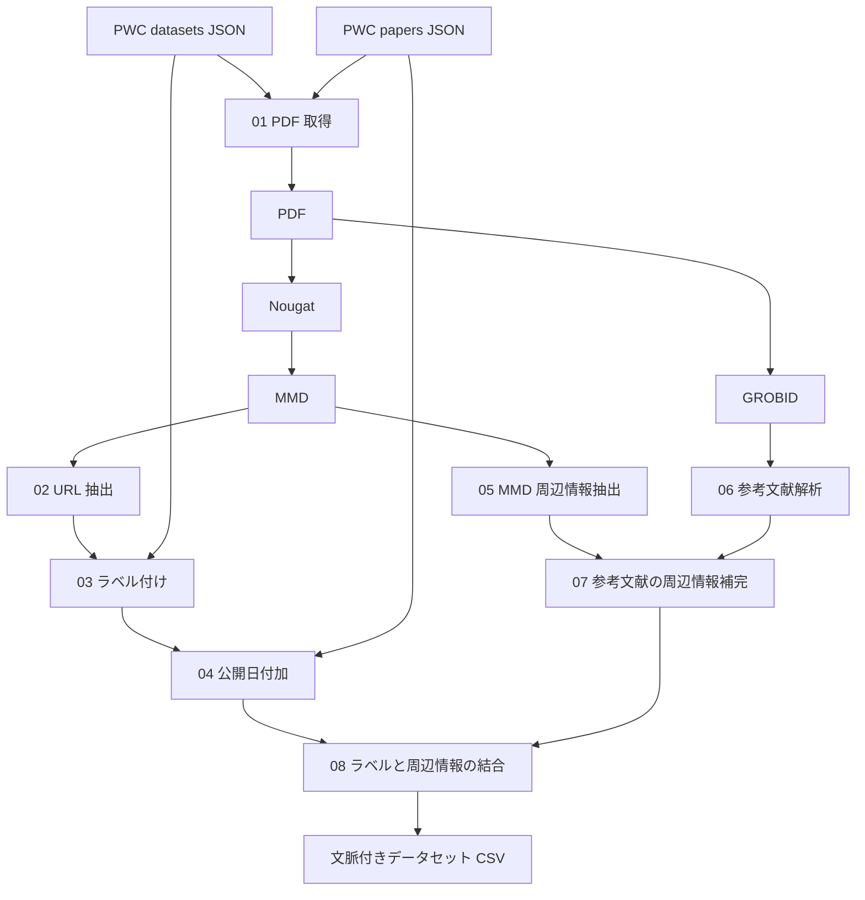

# 研究データ公開 URL データセットの構築手順

[English version / 英語版](README.md)

このディレクトリには、論文に記載された URL とその周辺文を収集し、研究データの公開先かどうかのラベルを付けたデータセットを作成するコードがあります。ラベル付けには Papers with Code（PWC）の登録情報を使い、論文 PDF のテキスト化には Nougat、参考文献の解析には GROBID を使います。

## 1. 全体の流れと各コードの役割



以下のパスはこのディレクトリからの相対パスです。

| スクリプト | 役割・入出力・現在の動作 |
| --- | --- |
| [`01_download_pdfs.py`](scripts/01_download_pdfs.py) | **論文PDFをダウンロードするためのプログラム。** 2 種の PWCD JSON を読み、データセット側の論文タイトルを papers 側と 完全一致で照合し、論文PDFを `data/pdf/` へ保存する。未一致・複数一致・URL なし・失敗を `data/logs/{not_found,many_match,no_url,failed_download}.json` に記録する。|
| [`02_extract_urls.py`](scripts/02_extract_urls.py) | **論文テキストから、データセットの候補となるURLを抽出するプログラム。** `data/mmd/` 直下の `*.mmd` を読み、`data/intermediate/extracted_urls.json` を `{ファイル名: [URL, ...]}` で出力する。|
| [`making_dataset_produce_or_not_url_classify.py`](scripts/making_dataset_produce_or_not_url_classify.py) | **PWCDの登録情報と照合し、抽出URLが研究データの公開先に一致するかを判定するプログラム。** PWCD datasets JSON と `extracted_urls.json` を読み、`03` から呼ぶ分類関数を提供する。|
| [`03_label_urls.py`](scripts/03_label_urls.py) | **各URLに公開先かどうかのラベルを付け、CSVにまとめるプログラム。** 上記の分類器を使い、`data/intermediate/labelled.csv` を作る。列は `id,name,homepage,paper_title,label`。正例 `Produce` は PWCD datasets の homepage、負例 `nonProduce` はその他の抽出 URL を使う。正例が 1 件以上ある論文の負例だけを残す。 |
| [`04_add_year.py`](scripts/04_add_year.py) | **URLのデータに論文の公開日を追加するプログラム。** `labelled.csv` と PWCD papers JSON を結合し、`data/intermediate/labelled_with_year.csv` を作る。列は `id,name,homepage,paper_title,year,label`。|
| [`05_parse_mmd_context.py`](scripts/05_parse_mmd_context.py) | **論文テキストから、URLが使われた文・段落・節や脚注情報を抽出するプログラム。** `data/mmd/` を再帰的に読み、`data/intermediate/pt_cs_ci_dict_output.json` を作る。`Body`・`Footnote`・`Reference` に分類し、引用タグを付ける。`en_core_web_trf` が必要。|
| [`grobid.py`](scripts/grobid.py) | **論文PDFを構造付きXMLに変換し、参考文献解析の入力を用意するプログラム。** |
| [`06_parse_tei_references.py`](scripts/06_parse_tei_references.py) | **参考文献のURLと、それを引用している本文の文・段落を対応付けて抽出するプログラム。** `data/xml/` を再帰的に読み、`data/intermediate/xml_ref_dict.json` を作る。 |
| [`07_add_reference_info.py`](scripts/07_add_reference_info.py) | **参考文献に含まれるURLの周辺情報を、本文中の引用情報で補完するプログラム。** `pt_cs_ci_dict_output.json` と `xml_ref_dict.json` を読み、`data/intermediate/url_around_info.json` と `reference_merge_report.json` を作る。|
| [`08_combine_context.py`](scripts/08_combine_context.py) | **URLのラベル・公開日と周辺文を結合し、文脈付きのデータセットを作るプログラム。** `labelled_with_year.csv` と `url_around_info.json` を結合し、`data/intermediate/dataset_with_context.csv` と `combine_report.json` を作る。|

## 2. フォルダ・ファイル構成

```text
data_construction_release/
├── .gitignore
├── README.md                 # 英語版 README
├── README_JA.md              # 日本語版 README
├── REVIEW_JA.md              # コードのレビュー記録
├── requirements.txt         # Python の依存パッケージ
├── scripts/                 # 上表のスクリプト
└── data/
    ├── input/               # PWC datasets / papers の入力 JSON
    ├── pdf/                 # 論文 PDF
    ├── mmd/                 # Nougat で変換した論文テキスト
    ├── xml/                 # GROBID で生成した full-text TEI XML
    ├── intermediate/        # 中間 CSV・JSON、最終データセット、結合レポート
    └── logs/                # PDF ダウンロードの記録
```

### 入力データと配布先

次の JSON を `data/input/` に配置します。ファイル名を変更する場合は、スクリプト内の入力パスも合わせて変更してください。

| 入力データ | 現在のファイル名 | 配布先リンク記入欄 |
| --- | --- | --- |
| PWC dataset JSON | `datasets_JST202508081105.json` | ［外部 GitHub リポジトリの URL をここに記入］ |
| PWC papers JSON | `papers-with-abstracts_JST202508081105.json` | ［外部 GitHub リポジトリの URL をここに記入］ |

## 3. 環境構築

- 64 ビット版 Python の仮想環境を用意し、[requirements.txt](requirements.txt) の依存を導入します。Python 3.12 を構築の基準とし、spaCy の英語モデル `en_core_web_trf` もこのファイルに含めています。モデルは[公式の 3.8.0](https://github.com/explosion/spacy-models/releases/tag/en_core_web_trf-3.8.0)を指定しています。
- PDF を MMD に変換するため、Nougat を別の仮想環境に導入します。
- PDF を XML に変換するため、GROBID サービスを用意し、`http://localhost:8070` で利用できる状態にします。
- `05`・`06` は既定で GPU を使います。GPU で実行する場合は、[spaCy の GPU 導入手順](https://spacy.io/usage#gpu)に従い、CUDA 環境に合う CuPy と PyTorch を追加で用意します。

## 4. 実行手順

作業ディレクトリを `data_construction_release/` にし、各段階の出力を確認しながら進めます。

1. **入力を準備する：** PWC の 2 種の JSON を `data/input/` に配置します。
2. **論文を変換する：** `01_download_pdfs.py` で PDF を取得し、Nougat で MMD に変換して `data/mmd/` に保存します。また、GROBID サービスを起動して `grobid.py` で XML を生成し、`data/xml/` に保存します。
3. **URL にラベルと公開日を付ける：** `02_extract_urls.py` → `03_label_urls.py` → `04_add_year.py` の順に処理します。
4. **URL の周辺情報を抽出する：** MMD を `05_parse_mmd_context.py`、XML を `06_parse_tei_references.py` で解析します。
5. **データを結合する：** `07_add_reference_info.py` → `08_combine_context.py` の順に処理し、最終 CSV と結合レポートを確認します。

PDF・MMD・XML は、同じ論文のファイル名を拡張子以外で揃えてください。MMD は `02` が読み込めるように `data/mmd/` 直下に置きます。

## 5. 出力データセットの内容

最終出力は `data/intermediate/dataset_with_context.csv` です。各行には、ラベル付き URL と、その URL の出現箇所に対応する以下の情報が入ります。

| 情報 | 主な列と内容 |
| --- | --- |
| 基本情報 | `id`、`name`、`paper_title`、`year`：ID、データセット名、論文タイトル、論文の公開日。 |
| URL とラベル | `homepage`、`label`：判定対象の URL と、PWC の登録情報に基づく `Produce` / `nonProduce` ラベル。 |
| 出現箇所 | `Passage-title`、`Citation-type`：節見出しと、本文・脚注・参考文献の区分。 |
| 周辺テキスト | `Citation-sentence`、`Citation-paragraph`、`Context-three-sentences`：URL または引用を含む文・段落と、同じ段落内の前後文。 |
| 引用・抽出情報 | `Citation-info`、`Source-URL`：脚注・参考文献の情報と、周辺情報側で抽出された URL。 |

`Produce` はその論文の研究データ公開先として PWC に登録された URL、`nonProduce` は分類処理で負例とされたその他の URL を表します。周辺情報と結合できなかった行は最終 CSV に含まれず、その記録は `combine_report.json` で確認できます。

`data/intermediate/` には、各処理段階の CSV・JSON と、参考文献補完の結果を記録する `reference_merge_report.json` も保存されます。

## 6. 本コードを使用した研究論文

- **論文情報（題名・著者・掲載先・年）：** ［ここに記入］
- **論文 URL または DOI：** ［論文へのリンクをここに記入］
