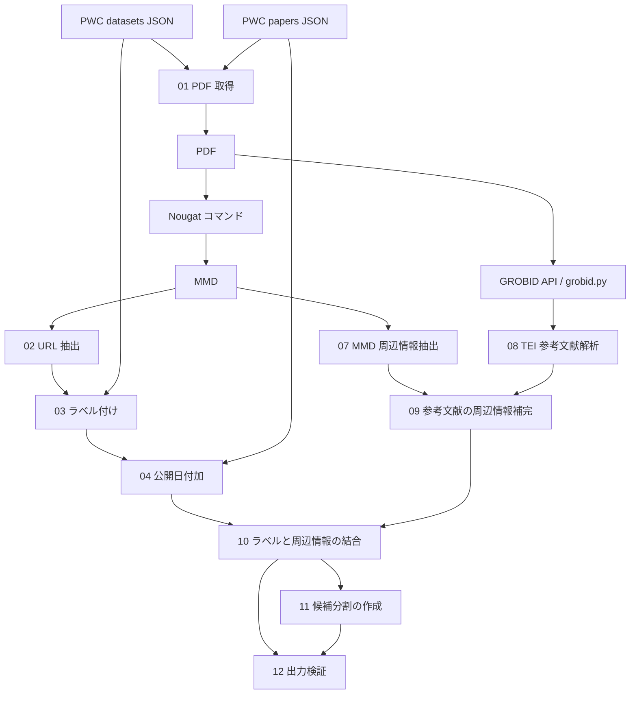

# 研究データ公開 URL データセットの構築手順

[English version / 英語版](README.md)

このディレクトリには、論文に記載された URL を抽出し、その論文の研究データの公開先として Papers with Code（PWC）に登録された homepage と一致するかをラベル付けするコードがあります。PDF の取得、**Nougat による `.mmd` への変換**、URL の抽出・分類、本文・脚注・参考文献の周辺情報付加、学習・開発・テスト用の候補データ作成までを扱います。参考文献の本文内引用情報には、GROBID が生成する full-text TEI XML を使います。


## 1. 全体の流れと各コードの役割



以下のパスはこのディレクトリからの相対パスです。`making_dataset.py` の CSV 出力は任意の事前確認です。`05`・`06` は過去の診断用コードで、通常の実行順には含めません。

| スクリプト | 役割・入出力・現在の動作 |
| --- | --- |
| [`making_dataset.py`](scripts/making_dataset.py) | `data/input/datasets_JST202508081105.json` を読み、`data/intermediate/pwc_pairs.csv` を出力する。列は `id,name,homepage,paper_title,label` で、全行を `Produce` とする。`paper` と `verified_paper` が両方ある場合は `paper` を優先。`01` 用の読み込み・タイトル重複除去関数も提供する。この CSV 自体は後続処理で読まない。 |
| [`01_download_pdfs.py`](scripts/01_download_pdfs.py) | 2 種の PWC JSON を読み、データセット側の重複除去済み論文タイトルを papers 側と **完全一致**で照合し、`url_pdf` を `data/pdf/` へ保存する。**既定は先頭 20 タイトルだけが対象**。未一致・複数一致・URL なし・失敗を `data/logs/{not_found,many_match,no_url,failed_download}.json` に記録する。HTTP 200 かつ PDF の Content-Type の場合に保存し、同名ファイルがあるとスキップ。部分一致という古いコメントは実際の動作と異なる。 |
| [`02_extract_urls.py`](scripts/02_extract_urls.py) | `data/mmd/` 直下の `*.mmd` を読み、`data/intermediate/perfect_extracted_urls.json` を `{ファイル名の stem: [URL, ...]}` で出力する。HTTP(S)/FTP の正規表現、分断 URL を延長しようとする `modify_url`、端の句読点除去、重複除去の後、最初の丸括弧で切り詰める。この最後の処理で再び重複が生じる場合がある。周辺文は出力しない。 |
| [`making_dataset_produce_or_not_url_classify.py`](scripts/making_dataset_produce_or_not_url_classify.py) | datasets JSON と `perfect_extracted_urls.json` を読み、`03` から呼ぶ分類関数を提供する。タイトル **と URL** の ASCII 英数字以外を除去して小文字にし、等値比較する。単独実行は集計表示のみで、データセットファイルは書かない。 |
| [`03_label_urls.py`](scripts/03_label_urls.py) | 上記の分類器を使い、`data/intermediate/labelled.csv` を作る。列は `id,name,homepage,paper_title,label`。正例 `Produce` は PWC homepage、負例 `nonProduce` は抽出 URL を使い、負例のデータセット名は空白。正例が 1 件以上ある論文の負例だけを残す。重複や分類上の注意は 7 節を参照。 |
| [`04_add_year.py`](scripts/04_add_year.py) | `labelled.csv` と papers JSON を元タイトルの **完全一致**で結合し、`data/intermediate/labelled_with_year.csv` を作る。列は `id,name,homepage,paper_title,year,label`。未一致行は削除する。`year` は年だけではなく、通常 `YYYY-MM-DD` の `date` 文字列全体。 |
| [`05_context_diagnostic_incomplete.py`](scripts/05_context_diagnostic_incomplete.py) | 日付付き CSV と **`data/input/pt_cs_ci_dict_output.json`** を読む。後者は `07` の出力場所とは異なる。タイトルの記号を除去するが空白・大文字小文字は保持し、一致件数を表示する。URL 照合と CSV 保存は未完成。宣言された `context_diagnostic_unused.csv` は生成されない。 |
| [`06_split_diagnostic_incomplete.py`](scripts/06_split_diagnostic_incomplete.py) | 日付付き CSV から論文を日付順に並べ、最新側 10% をテストとして選ぶ。残りから固定リストの 20 タイトルの除外を試み、seed 42 で最大 100 論文の年別サンプルを表示する。dev 分割と保存処理はコメントアウトされており、train/dev/test のファイルは生成しない。 |
| [`07_parse_mmd_context.py`](scripts/07_parse_mmd_context.py) | `data/mmd/` を再帰的に読み、`data/intermediate/pt_cs_ci_dict_output.json` を作る。空行で段落分割し、Markdown 見出しの階層管理、spaCy の文分割、`Footnote N:` と近傍の本文番号の推定対応付け、URL ごとのレコード展開を行う。`Body`・`Footnote`・`Reference` に分類し、引用タグを付ける。`en_core_web_trf` が必要。`DATASET_PARSER_CPU=1` でなければ `spacy.require_gpu()` を呼ぶ。 |
| [`grobid.py`](scripts/grobid.py) | PDF を multipart の `input` として `http://localhost:8070/api/processFulltextDocument` に POST し、同じ stem の full-text TEI XML を保存する。現在のソースには `/workspace/...` の固定入出力パス、別の `/mnt/ssd/研究/xml` を作る処理、PDF がなくても `input_files[0]` を参照する処理がある。別環境では 4 節の調整が必要。import する `tqdm` は `requirements.txt` にない。 |
| [`08_parse_tei_references.py`](scripts/08_parse_tei_references.py) | `data/xml/` を再帰的に読み、`data/intermediate/xml_ref_dict.json` を作る。TEI の `listBibl/biblStruct`、`ptr target`、本文の `ref type="bibr"` を対応付け、本文中の引用文・段落・見出し・書誌情報を取得する。見出しのキーは `Paragraph-title`。モデル・CPU 設定は `07` と同じ。実行される XML 解析は ElementTree で、lxml 版はコメントアウトだが import は残る。 |
| [`09_add_reference_info.py`](scripts/09_add_reference_info.py) | `pt_cs_ci_dict_output.json` と `xml_ref_dict.json` を読み、`data/intermediate/url_around_info.json` と `reference_merge_report.json` を作る。MMD に既存の `Reference` だけを補完する。タイトルは完全一致を優先し正規化一致を補助に使い、URL は **文字列の完全一致**。複数の TEI 文脈があれば展開し、未一致の MMD レコードは残る。XML だけにある URL は新規追加しない。 |
| [`10_combine_context.py`](scripts/10_combine_context.py) | `labelled_with_year.csv` と `url_around_info.json` を結合し、`data/intermediate/dataset_with_context.csv` と `combine_report.json` を作る。タイトルは完全一致を優先し正規化一致を補助に使い、URL の既定照合は分類器と同じ正規化。一致する出現箇所ごとに 1 行を作る。同一段落の対象文と前後文を付けるため、段落端では 3 文未満になる。未一致のラベル行は出力せずレポートに記録。 |
| [`11_split_candidate.py`](scripts/11_split_candidate.py) | 結合 CSV を読み、`data/intermediate/split_candidate/{train,dev,test}.csv` と `split_report.json` を作る。論文を日付・タイトル順に並べ、`max(1, round(論文数 * 0.1))` 論文ずつ最新側から test、dev に割り当て、残りを train にする。3 論文以上と正しい一貫した日付が必要。約 8:1:1 は **論文数**の比であり、行数の比ではない。新しい候補分割で、`06` の除外リストは適用しない。 |
| [`12_validate_outputs.py`](scripts/12_validate_outputs.py) | 結合 CSV、3 分割 CSV、結合レポートから `data/intermediate/validation_report.json` を作る。必須列、空でない出力、ラベル値、タイトル・URL の存在、レポート件数、重複を含む全行の分割一致、分割間の論文重複を確認する。構造エラーは終了コード 1。論文報告件数との差だけでは失敗にしない。 |

## 2. 入力とディレクトリ構成

PWC スナップショットは同梱されておらず、これらを取得するコードもありません。実験当時のアーカイブを入手し、以下の名前で配置してください。別スナップショットを使う場合は名前を合わせるか、対応するソースのパスをすべて変更します。入力が変われば結果も変わります。

```text
data_construction_release/
├── README.md
├── README_JA.md
├── requirements.txt
├── scripts/
├── original/                 # 過去の元コード
├── original_additional/     # 追加された元コード
└── data/
    ├── input/
    │   ├── datasets_JST202508081105.json
    │   └── papers-with-abstracts_JST202508081105.json
    ├── pdf/                 # 取得した PDF
    ├── mmd/                 # Nougat の出力
    ├── xml/                 # GROBID の full-text TEI
    ├── intermediate/        # CSV・JSON・レポート・split_candidate
    └── logs/                # ダウンロード・環境の記録
```

両 JSON は **トップレベルが配列**である必要があります。JSONL や辞書ではありません。以下は必要項目の例で、URL はダウンロード用テストデータではありません。

`datasets_JST202508081105.json`:

```json
[
  {
    "name": "Example Dataset",
    "homepage": "https://example.org/dataset",
    "paper": {"title": "Example Paper"},
    "verified_paper": null
  }
]
```

`papers-with-abstracts_JST202508081105.json`:

```json
[
  {
    "title": "Example Paper",
    "date": "2024-01-15",
    "url_pdf": "https://example.org/paper.pdf",
    "conference_url_pdf": null
  }
]
```

`paper`・`verified_paper` は両キーを設け、未使用側は `null` とします。`conference_url_pdf` も、値がなくてもキーが必要です。`01` が集計時に直接参照しますが、PDF 取得での代替 URL としては使いません。

PDF ファイル名ではタイトルに含まれる `\ / * ? : " < > |` を `_` に置換します。`Example Paper.pdf`・`Example Paper.mmd`・`Example Paper.xml` の stem（拡張子を除いた名前）を揃えてください。この名前がタイトルのキーになります。`02` は再帰探索しないため MMD は **`data/mmd/` 直下**に置きます。改名や名前の衝突は未一致・正規化タイトルの曖昧さの原因になります。

## 3. 環境構築

以下は **Python 3.10・CPU 解析**で始める例で、実験当時の環境の復元ではありません。構文上は Python 3.9 以上ですが、依存パッケージの互換性も必要です。`requirements.txt` はバージョン未固定です。Nougat は Transformer・画像処理の依存があるため専用環境に分けます。

| 依存関係 | 用途 |
| --- | --- |
| `requests` | PDF 取得、GROBID 通信 |
| `pandas` | `03` の CSV 処理。`07`・`08` でも import |
| `scikit-learn` | 過去の診断用 `06` |
| `spacy`、`spacy-transformers` | `07`・`08`・`10` の文分割 |
| `en_core_web_trf` | 別途取得する英語 Transformer モデル |
| `lxml` | `08` の import。別案の解析処理は未使用 |
| `tqdm` | GROBID の進捗表示。別途導入が必要 |
| `nougat-ocr` | 専用環境の PDF → MMD コマンド |
| Docker + GROBID イメージ | PDF → TEI サービス。pip 依存ではない |

Python 導入と仮想環境作成には uv を使います。公式の [インストール手順](https://docs.astral.sh/uv/getting-started/installation/)と [Python 管理手順](https://docs.astral.sh/uv/guides/install-python/)を参照してください。

### 3.1 Linux / WSL（Bash）

Windows で WSL を使う場合は、管理者 PowerShell で次を実行し、必要なら再起動し、Ubuntu を開いて初回のユーザー設定を終えます。[Microsoft の WSL 手順](https://learn.microsoft.com/en-us/windows/wsl/install)も参照してください。

```powershell
wsl --install -d Ubuntu
```

以下は **Ubuntu / Bash 内**で実行します。PowerShell 用ではありません。

```bash
sudo apt update
sudo apt install -y curl ca-certificates
curl -LsSf https://astral.sh/uv/install.sh | sh
```

案内に従ってターミナルを開き直してください。次のパスは実際の配置先に置き換えます。WSL からは Windows のファイルを `/mnt/c/` 以下で参照できます。

```bash
cd '/path/to/data-producing/data_construction_release'
uv --version
uv python install 3.10
uv venv --python 3.10 --seed .venv
.venv/bin/python -m pip install -r requirements.txt
.venv/bin/python -m pip install tqdm
.venv/bin/python -m spacy download en_core_web_trf
.venv/bin/python -m spacy validate
.venv/bin/python --version
mkdir -p data/input data/pdf data/mmd data/xml data/intermediate data/logs
export PYTHONUTF8=1
export DATASET_PARSER_CPU=1
```

モデルはスクリプトと **同じ環境**に導入します。[spaCy のモデル導入手順](https://spacy.io/usage/models)も参照してください。`PYTHONUTF8=1` は encoding 未指定の古い `open()` を UTF-8 で動かすためです。CPU 指定は `07`・`08` の GPU 必須処理を回避します。CPU では時間がかかる場合があります。次回以降もこの場所へ移動して環境変数を再設定します。`.venv/bin/python` の明示により activate は不要です。

### 3.2 Windows ネイティブ（PowerShell）

uv を導入して PowerShell を開き直します。

```powershell
winget install --id=astral-sh.uv -e
```

以下は `data-producing/` から始める例です。すでに `data_construction_release/` にいれば `Set-Location` を省きます。

```powershell
Set-Location .\data_construction_release
uv --version
uv python install 3.10
uv venv --python 3.10 --seed .venv
$Python = ".\.venv\Scripts\python.exe"
& $Python -m pip install -r requirements.txt
& $Python -m pip install tqdm
& $Python -m spacy download en_core_web_trf
& $Python -m spacy validate
& $Python --version
New-Item -ItemType Directory -Force -Path data/input,data/pdf,data/mmd,data/xml,data/intermediate,data/logs | Out-Null
$env:PYTHONUTF8 = "1"
$env:DATASET_PARSER_CPU = "1"
```

新しいターミナルでは `$Python` と環境変数を再設定します。実行ファイルを明示するため activate 関連の設定は不要です。以下の Bash 例は `.venv/bin/python` を `& $Python` に読み替えます。5 節に PowerShell の実行順もまとめています。

### 3.3 GPU で解析する場合（任意）

`07`・`08` の GPU 実行には、対応する NVIDIA ドライバ、PyTorch、CuPy / spaCy の CUDA 依存を整えます。公式の [PyTorch](https://pytorch.org/get-started/locally/)、[spaCy GPU](https://spacy.io/usage#gpu)、[CuPy](https://docs.cupy.dev/en/stable/install.html) 導入手順を使ってください。リポジトリの requirements だけでは GPU 環境は揃いません。構築後、メイン環境で確認して CPU 指定を外します。

```bash
.venv/bin/python -c "import torch, spacy; print('torch CUDA:', torch.cuda.is_available()); spacy.require_gpu(); print('spaCy GPU ready')"
unset DATASET_PARSER_CPU
```

PowerShell:

```powershell
& $Python -c "import torch, spacy; print('torch CUDA:', torch.cuda.is_available()); spacy.require_gpu(); print('spaCy GPU ready')"
Remove-Item Env:DATASET_PARSER_CPU -ErrorAction SilentlyContinue
```

`10` は GPU を明示的に選択せずモデルを読み込みます。`DATASET_PARSER_CPU` を使うのは `07`・`08` だけで、Nougat のデバイス指定にはなりません。

## 4. 全件実行前のソース調整

この文書は、以下のソース変更を自動的に適用するものではありません。

### 4.1 PDF 取得の 20 論文制限を解除する

全件実行には `scripts/01_download_pdfs.py` を変更します。

```python
# 現在の小規模実行用の制限:
papers_title_list = making_dataset.paper_verified_paper_nodup(dataset_li)[:20]
# 全件実行では、上の行を次の行に置き換える:
papers_title_list = making_dataset.paper_verified_paper_nodup(dataset_li)
```

最初の確認では前者を残せます。制限するのは重複除去済みの論文タイトル数で、データセットレコード数や最終 URL 行数ではありません。`--limit` オプションはありません。

### 4.2 GROBID のパスを現在の作業場所に合わせる

元の Linux 配置以外で使う場合は `scripts/grobid.py` を変更します。

1. PDF 一覧の取得を `input_files = glob.glob("data/pdf/*.pdf")` にする。
2. 単独の `input_files[0].split(...)` の行を削除する。PDF がないとエラーになるため。
3. `/mnt/ssd/研究/xml` の作成を `os.makedirs("data/xml", exist_ok=True)` にする。
4. ループ内で `output_file_name = os.path.splitext(os.path.basename(input_file))[0]`、`output_file = os.path.join("data/xml", f"{output_file_name}.xml")` を使う。

8070 番ポートでサービスに接続できるなら、ローカルのサーバー URL はそのまま使います。この変更は Bash と Windows ネイティブの両方で使えます。PDF の存在を確認してください。元のコードは XML を上書きし HTTP エラーを表示しますが、通信タイムアウトや再試行の設定はありません。

## 5. 0 からの実行手順

各段階の出力を確認してから次へ進みます。番号付きファイルのワイルドカード実行はしないでください。`05`・`06` は未完成の診断用コードで、Python 処理の間には Nougat・GROBID の実行も必要です。

### 5.1 任意の PWC CSV 出力と PDF 取得

先に 2 つの入力 JSON を置き、`[:20]` を残すか解除するかを決めます。

```bash
.venv/bin/python scripts/making_dataset.py
.venv/bin/python scripts/01_download_pdfs.py
ls data/pdf/*.pdf
```

最初のコマンドは任意です。`01` は関数を import しますが `pwc_pairs.csv` は必要ありません。ダウンロードログを確認します。既存 PDF の内容は検証されません。ログは追記なので再実行で重複する場合があります。表示される取得対象数は成功件数ではありません。

### 5.2 Nougat コマンドで PDF を MMD にする

Git の除外対象である **`.venv/` 内**に Nougat 専用環境を作ります。

```bash
uv venv --python 3.10 --seed .venv/nougat
.venv/nougat/bin/python -m pip install nougat-ocr
.venv/nougat/bin/nougat --help
.venv/nougat/bin/nougat data/pdf -o data/mmd -m 0.1.0-small
ls data/mmd/*.mmd
```

導入、ディレクトリ入力、モデル指定は [Nougat の公式説明](https://github.com/facebookresearch/nougat)に沿っています。これは例であり、実験当時の正確なコマンドを確認したものではありません。実際のコマンド・モデル・オプションを記録します。初回はモデル取得が発生する場合があります。PDF と MMD の stem を揃えてください。

すでに Nougat で取得した MMD がある場合は `data/mmd/` 直下に置いて変換を省略できます。見出し・脚注・URL を確認します。`[MISSING_PAGE]` が多い場合、公式では `--no-skipping` を案内しています。`--recompute` は既存結果も作り直します。これらは後続の結果に影響します。

PowerShell:

```powershell
uv venv --python 3.10 --seed .venv/nougat
& .\.venv\nougat\Scripts\python.exe -m pip install nougat-ocr
& .\.venv\nougat\Scripts\nougat.exe --help
& .\.venv\nougat\Scripts\nougat.exe data/pdf -o data/mmd -m 0.1.0-small
Get-ChildItem data/mmd -Filter *.mmd
```

Windows で GPU を使う場合、Nougat 公式では適切な PyTorch を先に導入するよう案内しています。導入先は **Nougat 専用環境**です。

### 5.3 URL 抽出・ラベル付け・公開日付加

```bash
.venv/bin/python scripts/02_extract_urls.py
.venv/bin/python scripts/03_label_urls.py
.venv/bin/python scripts/04_add_year.py
```

順に `data/intermediate/perfect_extracted_urls.json`、`labelled.csv`、`labelled_with_year.csv` ができます。`03` が読むのは **`perfect_extracted_urls.json`** で、`no_kagikakko_extracted_urls.json` ではありません。現在の `scripts/` に `02b_trim_parentheses_optional.py` はありません。

### 5.4 MMD の周辺情報抽出

```bash
export DATASET_PARSER_CPU=1
.venv/bin/python scripts/07_parse_mmd_context.py
```

出力は `data/intermediate/pt_cs_ci_dict_output.json` です。モジュール直下で実行し、すぐにモデルを読み込み、最後に JSON 全体を保存します。CLI オプションや論文単位の途中再開機能はありません。入力が空・読めない、見出しや文脈が認識できない場合などに、URL 抽出よりもレコードが少なくなることがあります。

### 5.5 GROBID を起動して full-text TEI XML を取得する

[Windows 用 Docker Desktop](https://docs.docker.com/desktop/setup/install/windows-install/) または [Linux 用 Docker Engine](https://docs.docker.com/engine/install/) を導入します。Linux コンテナを起動し、WSL を使う場合は対象ディストリビューションとの連携を有効にします。`docker version` が通ることを確認します。

以下は例としてタグを明示しており、実験当時のバージョンを復元したものではありません。full イメージには参考文献処理用モデルが含まれます。[GROBID の Docker 手順](https://grobid.readthedocs.io/en/latest/Grobid-docker/)を参照してください。

```bash
docker pull grobid/grobid:0.9.1-full
docker run -d --name grobid-data-construction --init --ulimit core=0 -p 8070:8070 grobid/grobid:0.9.1-full
docker logs grobid-data-construction
curl -f http://localhost:8070/api/isalive
```

初期化と正常応答を待ちます。イメージが大きく、CPU 処理は時間がかかる場合があります。同名コンテナを作成済みなら `docker start grobid-data-construction` を使います。8070 番ポートを空けておく必要があります。この例は CPU 実行で、GPU コンテナには追加設定が必要です。

4.2 節の変更後:

```bash
.venv/bin/python scripts/grobid.py
ls data/xml/*.xml
.venv/bin/python scripts/08_parse_tei_references.py
```

`data/xml/<PDF の stem>.xml` と `data/intermediate/xml_ref_dict.json` ができます。任意の XML や参考文献だけの出力ではなく、書誌構造と本文引用リンクを含む full-text TEI を使います。API・multipart 送信の説明は [GROBID REST API](https://grobid.readthedocs.io/en/latest/Grobid-service/)にあります。

対応する TEI がすでにあれば `data/xml/` に置き、生成処理を省略して `08` から実行できます。終了後にサービスを止めます。

```bash
docker stop grobid-data-construction
```

### 5.6 結合・分割・検証

```bash
.venv/bin/python scripts/09_add_reference_info.py
.venv/bin/python scripts/10_combine_context.py
.venv/bin/python scripts/11_split_candidate.py
.venv/bin/python scripts/12_validate_outputs.py
```

最終成果物:

- `data/intermediate/dataset_with_context.csv`: ラベルと出現箇所の周辺情報を結合した CSV。
- `data/intermediate/split_candidate/train.csv`・`dev.csv`・`test.csv`: 候補分割。
- `data/intermediate/` の `reference_merge_report.json`・`combine_report.json`・`validation_report.json`、`split_candidate/` の `split_report.json`。

7 節のレポートを確認してください。`12` は 3 分割すべてと結合レポートが必要です。終了コード 0 でも、実験当時の完全再現や文脈の正確さを保証しません。

### 5.7 PowerShell の実行順まとめ

環境構築・入力配置・4 節の変更後に使う Windows ネイティブ版です。出力を確認しながら進め、MMD・XML が取得済みなら生成処理を省略します。

```powershell
$Python = ".\.venv\Scripts\python.exe"
$env:PYTHONUTF8 = "1"
$env:DATASET_PARSER_CPU = "1"
& $Python scripts/making_dataset.py
& $Python scripts/01_download_pdfs.py

# 先に 5.2 節の Nougat 専用環境を作成・導入する。
& .\.venv\nougat\Scripts\nougat.exe data/pdf -o data/mmd -m 0.1.0-small
& $Python scripts/02_extract_urls.py
& $Python scripts/03_label_urls.py
& $Python scripts/04_add_year.py
& $Python scripts/07_parse_mmd_context.py

# 先に Docker Desktop を起動する。
docker pull grobid/grobid:0.9.1-full
docker run -d --name grobid-data-construction --init --ulimit core=0 -p 8070:8070 grobid/grobid:0.9.1-full
docker logs grobid-data-construction
Invoke-RestMethod -Uri http://localhost:8070/api/isalive
# 正常な初期化が終わってから PDF を送信する。
& $Python scripts/grobid.py
& $Python scripts/08_parse_tei_references.py
& $Python scripts/09_add_reference_info.py
& $Python scripts/10_combine_context.py
& $Python scripts/11_split_candidate.py
& $Python scripts/12_validate_outputs.py
$LASTEXITCODE
docker stop grobid-data-construction
```

### 5.8 TEI を使わない MMD のみの実行（任意）

TEI がない場合、`04`・`07` の後で次を実行できます。

```bash
.venv/bin/python scripts/10_combine_context.py --contexts data/intermediate/pt_cs_ci_dict_output.json
.venv/bin/python scripts/11_split_candidate.py
.venv/bin/python scripts/12_validate_outputs.py
```

`08`・`09` を省略し、TEI の本文引用で補完せず MMD の参考文献文脈を保持します。この選択を記録してください。既定の出力名は同じなので、両結果を残す場合は作業コピーを分けるかカスタムパスを指定します。

## 6. 出力列と CLI オプション

結合 CSV は `id,name,homepage,paper_title,year,label` を保持し、以下を追加します。

| 列 | 内容 |
| --- | --- |
| `Passage-title` | 見出し階層。CSV セルでは JSON 配列の文字列。 |
| `Citation-sentence` | URL、またはその脚注・参考文献引用を含む文。 |
| `Citation-info` | 脚注や書誌情報。本文 URL では通常空。`08` の書誌情報は Python 辞書の文字列表現であり、JSON オブジェクトではない。 |
| `Citation-paragraph` | 対象文・引用を含む段落。 |
| `Citation-type` | `Body`・`Footnote`・`Reference`。 |
| `Context-three-sentences` | 同一段落の対象文と前後文。対応付け失敗時は対象文にフォールバック。 |
| `Source-URL` | 周辺情報側の抽出 URL。ラベル側の homepage と別に保持する。 |

正例の `homepage` は `Source-URL` と文字列として異なる場合があります。タグは `[Cite]`・`[Cite_Ref]`・`[Cite_Footnote_N]` などです。`id` はラベルから引き継ぎ、複数文脈に展開すると重複するため、出現箇所単位で一意ではありません。

argparse のオプションがあるのは `09`～`12` です。`.venv/bin/python scripts/<ファイル名>.py --help`（PowerShell は `& $Python ...`）で確認できます。モジュール直下で実行する `07`・`08`・`grobid.py` に `--help` を付けないでください。

| スクリプト | オプション |
| --- | --- |
| `09_add_reference_info.py` | `--mmd`・`--xml`・`--out`・`--report` |
| `10_combine_context.py` | `--labels`・`--contexts`・`--out`・`--report`・`--url-mode normalized\|exact\|legacy-substring`・`--skip-three-sentences` |
| `11_split_candidate.py` | `--input`・`--out-dir` |
| `12_validate_outputs.py` | `--combined`・`--split-dir`・`--combine-report`・`--report` |

`10` の既定は正規化 URL の等値比較です。`exact` は完全一致、`legacy-substring` はラベル側 homepage が周辺情報側 URL に含まれるかを判定します。結合だけを変更し、`03` のラベルは変わりません。`--skip-three-sentences` は構造確認用で、その列を空にします。カスタムパスは後続引数にも引き継いでください。

## 7. 結果の確認と環境の記録

| レポート | 確認内容 |
| --- | --- |
| ダウンロードログ | タイトルの未一致・複数一致、`url_pdf` なし、HTTP / Content-Type の失敗。該当事象がなければファイルがない場合もある。 |
| `reference_merge_report.json` | `unmatched_reference_contexts`、`xml_papers_without_mmd`、一致・展開件数。URL の文字列差で補完できない場合がある。 |
| `combine_report.json` | `unmatched_title_rows`、`unmatched_url_rows`、`matched_labeled_rows`、`output_occurrences`、`context_status`。入力欠落や `sentence_not_found_in_paragraph` は通常どおり前後文を取得できていない状態。 |
| `split_candidate/split_report.json` | 論文数・行数、日付範囲、正例数、`published_row_counts_match`。 |
| `validation_report.json` | `structural_errors`、`actual_counts`、`published_counts_match`、ラベル集計、未一致・文脈の集計。 |

`12` の比較対象は、全体 17,977 行、正例 3,185 行、train/dev/test が 13,715/1,635/2,627 行です。件数が一致しても、例の内容や分割対象が同じとは限りません。

解釈上の注意:

- 分類器は論文ごとに PWC homepage と抽出 URL をすべて組み合わせます。homepage が複数あると同じ URL が正負両方に入り得ます。正負の重複も残ります。正例の名前は元タイトルが最初に一致したレコード由来で、homepage の所有データセット名とは限りません。
- ASCII 英数字への正規化は URL の記号やパスの大文字小文字を失い、別 URL・タイトルを同一視する場合があります。`09`・`10` は索引対象の正規化タイトル衝突をエラーにしますが、前段の重複除去とは動作が異なります。
- `04` はタイトル未一致を削除し、一致した論文の空日付は保持します。`11` は欠落・不正・不一致の日付を受け付けません。
- `07` は推定規則で、未対応脚注の脱落、見出し整形の不完全さ、複数脚注 URL による重複などがあり得ます。`08` は不正 XML をスキップし、本文参照を解決できない場合は文脈が得られません。`09` は MMD に既存の参考文献だけを補完します。代表例を目視確認してください。
- 複数文脈やラベル重複で結合 CSV の行数が増えます。`12` が検証するのは構造と分割であり、ラベルの正しさ、重複排除、周辺情報の完全性、元ラベルの全件保持ではありません。

導入済みバージョン、入力ハッシュ、Nougat コマンド・モデル、GROBID イメージ・設定、CPU/GPU 選択、ソース変更を記録します。

```bash
.venv/bin/python -m pip freeze > data/logs/python_requirements_resolved.txt
.venv/nougat/bin/python -m pip freeze > data/logs/nougat_requirements_resolved.txt
docker image inspect grobid/grobid:0.9.1-full > data/logs/grobid_image.json
sha256sum data/input/*.json > data/logs/input_sha256.txt
```

PowerShell:

```powershell
& $Python -m pip freeze | Out-File -Encoding utf8 data/logs/python_requirements_resolved.txt
& .\.venv\nougat\Scripts\python.exe -m pip freeze | Out-File -Encoding utf8 data/logs/nougat_requirements_resolved.txt
docker image inspect grobid/grobid:0.9.1-full | Out-File -Encoding utf8 data/logs/grobid_image.json
Get-FileHash data/input/*.json -Algorithm SHA256 | Format-List | Out-File -Encoding utf8 data/logs/input_sha256.txt
```

未使用ツールの記録は省略します。多くの JSON / CSV は再実行で上書きされるため、入力や設定の変更前に前回結果を保存します。このディレクトリの `.gitignore` は入力、PDF、MMD、XML、中間出力、ログ、`.venv/` を除外します。

## 8. よくある問題

| 症状 | 対処 |
| --- | --- |
| `data/...` の `FileNotFoundError` | 作業場所、必要なディレクトリ、入力名、前段の出力を確認する。 |
| PDF が最大 20 論文だけ | 全件実行では `01` の `[:20]` を外す。 |
| `ModuleNotFoundError: tqdm` | メイン環境で `.venv/bin/python -m pip install tqdm` を実行する。 |
| `en_core_web_trf` がない | メイン環境の Python でモデルを取得する。 |
| spaCy GPU / CuPy エラー | Bash で `DATASET_PARSER_CPU=1`、PowerShell で `$env:DATASET_PARSER_CPU = "1"` を設定するか GPU 依存を整える。 |
| `UnicodeDecodeError` | Python 起動前に `PYTHONUTF8=1` を設定し、入力が UTF-8 か確認する。 |
| Nougat の依存・import エラー | 専用の Python 3.10 環境で `python -m pip check` を使い、バージョンを記録して公式の互換性情報を確認する。過去の動作バージョンは不明で、ここではモデルを使った全体実行までは確認していない。 |
| GROBID の `IndexError`・パスエラー・XML がない | 4.2 節の全変更、PDF、`tqdm`、8070 番ポートの応答を確認する。 |
| GROBID 接続・HTTP エラー | Docker ログ、初期化、ポート、メモリを確認し、準備完了後に再試行する。 |
| URL / 周辺情報が空 | MMD が直下にあるか、URL スキーム、見出し・脚注形式、full-text TEI の書誌・本文リンクを確認する。 |
| `Ambiguous normalized title` | 表示された stem / タイトルを確認し、重複入力や名前衝突を解消する。 |
| `11` が失敗する | 結合後に 3 論文以上と正しい日付が必要。`04` と結合レポートを確認する。 |
| `12` の構造エラー | 検証レポートを読み、前段の出力やカスタムパスを修正する。論文件数との差だけでは終了コード 1 にならない。 |

両言語の README は現在のソースのパス・CLI 定義に照合しています。文書作成に際して PDF 全件取得、Nougat 推論、spaCy モデル実行、GROBID 処理の全体実行は行っていません。
